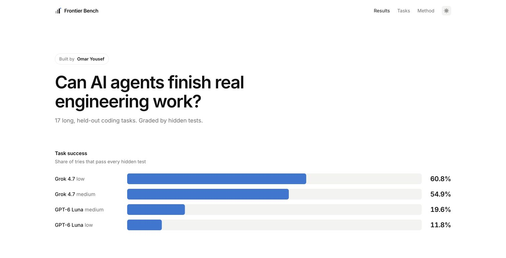

# Frontier Bench

### Can AI agents finish real engineering work?

17 held-out engineering tasks. Three attempts per configuration. Hidden executable tests.

**Built by [Omar Yousef](https://github.com/huslayer826)**

[Explore the live benchmark](https://frontier-bench-omar.vercel.app) · [Methodology](docs/METHODOLOGY.md) · [Results & disclosures](docs/RESULTS.md)

 

<picture>
  <source media="(prefers-color-scheme: dark)" srcset="docs/images/leaderboard-dark.png" />
  
</picture>

 

## Engineering work, measured by execution

Frontier Bench measures whether coding agents can carry an engineering task through to a working result. Each attempt starts in a fresh, isolated environment. The submitted work must pass every required hidden check and milestone to succeed.

The website brings together configuration-level scores, per-task outcomes, timing, and sanitized evidence fingerprints. You can follow a headline number through to the attempts behind it.

| Frozen release | Task coverage | Evaluation size | Scoring |
| :--- | :--- | :--- | :--- |
| `long-horizon-v0.7` | 17 held-out tasks | 51 valid attempts per complete configuration | Equal weight per task |

## Published results

| Configuration | Reasoning | Task success | Passed / valid | Result type |
| :--- | :--- | ---: | ---: | :--- |
| [Grok 4.7](https://frontier-bench-omar.vercel.app/runs/grok47-low-completion-3885241c) | Low | **60.8%** | 31 / 51 | Development campaign · 2 declared replacements |
| [Grok 4.7](https://frontier-bench-omar.vercel.app/runs/grok47-medium-completion-284d5b0f) | Medium | **54.9%** | 28 / 51 | Development campaign · 1 declared replacement |
| [GPT-6 Luna](https://frontier-bench-omar.vercel.app/runs/623df4c46a694e18806d0c9797727987) | Medium | **19.6%** | 10 / 51 | Development run · grading amendment |
| [GPT-6 Luna](https://frontier-bench-omar.vercel.app/runs/luna-low-completion-0a70b41cdaf4) | Low | **11.8%** | 6 / 51 | Development campaign · 2 declared replacements |

Snapshot: **October 24, 2026**. The [live site](https://frontier-bench-omar.vercel.app) is the current presentation; [result notes](docs/RESULTS.md) explain the underlying configurations and recovery history.

These are development measurements, not official rankings. Completion campaigns retain the original infrastructure interruptions and use separately declared replacement attempts. No valid failure was rerun. The model clients and verifier fingerprints differ across configurations; read the run details before drawing comparisons. Backend model identity is not independently attested.

## Explore

<table>
<tr>
<td width="50%">

**[Results](https://frontier-bench-omar.vercel.app)**  
Compare published model configurations and inspect each completed run.

</td>
<td width="50%">

**[Methodology](https://frontier-bench-omar.vercel.app/methodology)**  
Understand scoring, isolation, controls, uncertainty, and limitations.

</td>
</tr>
<tr>
<td>

**[Trial explorer](https://frontier-bench-omar.vercel.app/data/trials)**  
Browse the sanitized outcomes behind the headline numbers.

</td>
<td>

**[Updates](https://frontier-bench-omar.vercel.app/changelog)**  
Follow the benchmark's published history.

</td>
</tr>
</table>

## About this repository

This is the **public showcase** for Frontier Bench. It contains documentation, result summaries, and screenshots only.

The website source, evaluation engine, task packages, prompts, graders, reference solutions, candidate submissions, and raw execution traces are kept in private repositories or private evidence storage. None of those are included in this repository or its Git history.

The live site exposes sanitized measurements and generic task aliases. The held-out task material remains private to preserve the benchmark's usefulness.

## Feedback

For questions about the published results, methodology, or website, [open an issue](https://github.com/huslayer826/frontier-bench-public/issues). Please keep submissions free of credentials, private task material, and raw execution traces.

---

Created and maintained by **[Omar Yousef](https://github.com/huslayer826)**. Frontier Bench is an independent project.
